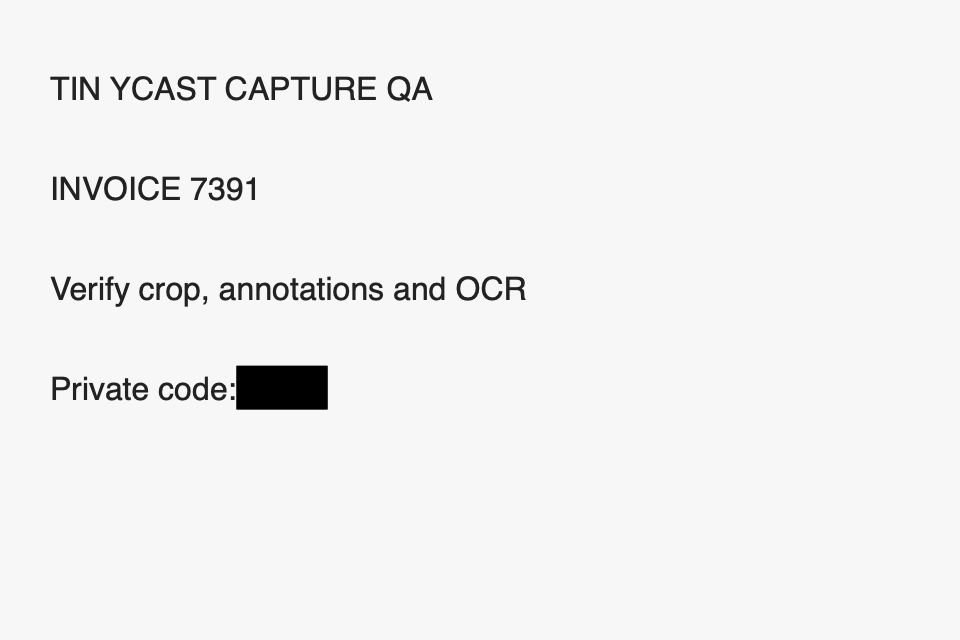
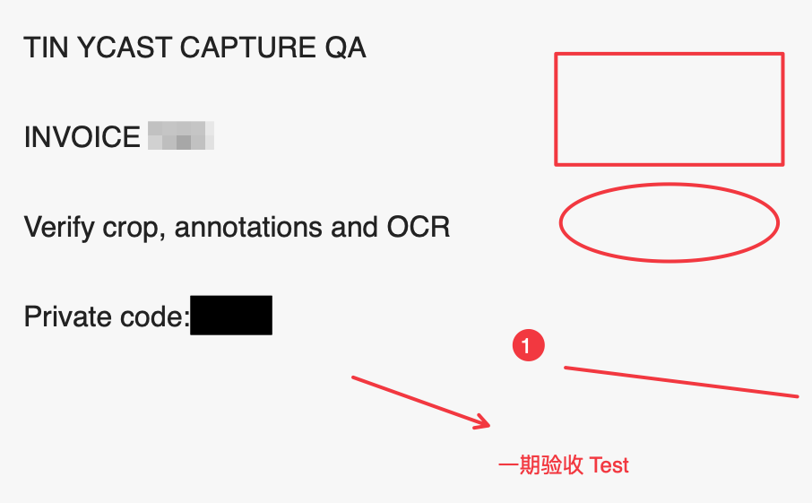

# Capture 一期实现与验收记录

2026-09-24，当前 checkout 的未提交实现。**一期未验收完成**：真实 SCK 选区及取消、编辑器复制到 Preview
并解码、历史单次接收已有证据。普通选区 Return 直接复制到 Preview 并再导出也已通过；
Arc 样例的纵/横向、手动/自动长图均已完成多帧输出和像素/编号检查；完整场景矩阵尚未走完，
当时的 100 MB resident memory 门槛失败；2026-09-29 已按用户要求采用 [Spec v3 场景预算](capture-spec.md#内存和性能-gate)，须独立复验。
用户已明确允许 Screen Recording 和 Accessibility，不能继续将缺少用户授权列为阻塞。

统一工作区设计获批后的增量实现与验证见[落地记录](capture-workspace-implementation.md)。
下表保留一期证据；旧选区条已由原位工作区替换，不能直接沿用旧 UI 的验收结论关闭新流程。

## 实现范围

| 范围 | 当前代码 | 验收状态 |
| --- | --- | --- |
| 8 个命令、Capture 设置、别名/热键归属、Clipboard 四个图片动作 | 已接通同一个 coordinator | 原生命令搜索、历史入口通过；全局热键未验 |
| 区域/窗口/全屏、普通选区直接复制 | SCK、选区遮罩与输出已接通 | 真实选区、取消、Return 直接复制到 Preview 并再导出通过；窗口/全屏输出待验 |
| 纵向/横向、手动/自动长截图 | 稳定帧、RGB 配准、不可变条带、暂停/重选/完成、目标检查已接通 | Arc 四种组合均有真实多帧 PNG，编号连续、接缝间距和历史单次记录通过；固定区域、PDF/原生列表及完整中断矩阵待验 |
| 常用标注、裁剪、撤销/重做 | 原生画布和文本编辑已接通 | 各工具基础操作、移动/改色、裁剪撤销/重做、导出和首次 fit 通过；TextKit 组词、Unicode、换行、复制、撤销 harness 通过，实际输入法候选窗未遍历 |
| PNG/JPEG/HEIC、复制 | PNG 原子流式输出；JPEG/HEIC 有像素上限；复制保留 8 MB 编码上限 | 原生 PNG 保存通过；JPEG/HEIC 独立解码验证尺寸和遮盖、超限保留旧文件通过；906 × 561 编辑器 Copy → Preview 解码与历史单次接收通过 |
| 贴图 | 三个有界预览、租约、拖动/缩放、透明度、编辑/关闭 | 关闭编辑器后贴图保留、返回编辑、hover 操作条、透明度菜单、Close 已复验；48 MP/三贴图/OCR/PNG 组合 20 轮通过；多 Space 待验 |
| OCR | 原像素重叠分块、遮盖后取字、坐标去重、超时/取消回收 | 真实 Vision harness 和原生测试图通过；20 px 中英混合长图新增样本通过，包含中文和数字的识别断言 |
| Translation | 复用现有引擎、预览、校正、复制；清空回填目标、失焦保留 | 配置的 AI 引擎真实译文通过；截图菜单已实测仅保留 Translate Again，不再出现回填项；Apple 语言包分支未验 |
| 历史/草稿 | 默认平面、原稿显式保留、损坏侧车回退、安全重开、保留期 | 仓储故障 fixture、原生平面历史重开、草稿保存/重启恢复通过；超过一天且未被进程持有的 session 会回收，活跃文件租约跳过有 fixture 证据 |
| 生命周期与样式 | 取消、退出、显示器/锁屏/休眠 observer、InterfaceMetrics | 实际锁屏发现选区资源仍被持有，已补中断监听和定向测试；新构建锁屏复验、授权撤销/断屏/VoiceOver/全字号/两种外观未全部验证 |

## 自动化与构建

- 2026-09-24 完整 `./Scripts/run-tests.sh`：**82/82 通过，62 秒**；前一轮为 76 秒。
  新增 `capture-editor-test`、`capture-session-test`；workflow
  补充 PNG 编码复制上限、JPEG/HEIC 裁剪与遮盖、超限原文件保护、非整倍数缩略图分块接缝回归。
  pasteboard、clipboard-text、Translation 和真实 Vision OCR 同次通过；中断监听覆盖锁屏、休眠、会话切出、
  显示器变化，以及释放后排队通知不再回调。此前一轮 81/81 通过后，因实际锁屏发现资源未释放，修复并增加第 82 个 harness。
- 本轮增加 CoreText 中英编号列表 fixture：900 × 600 视口，每次位移 83 px，覆盖正向、反向、重复帧和
  固定页头/页尾；随后追加实际条带组合，最终 900 × 849 的每行 RGBA 与原图逐像素一致。
  定向测试通过（26 秒，含编译）。
  此证据不替代浏览器的实时采样和自动滚动。
- 根据原生现场增加可见性回归：前台目标窗口、系统指针、透明窗口、自身边框、真实遮挡、窗口移动、目标消失。
  旧判断在鼠标进入选区时复现失败；修复后定向测试通过（23 秒，含编译），完整 82 项通过。
  窗口数据和前台 PID 作为纯策略参数，系统 cursor layer 由 `CGWindowLevelForKey` 注入。
  补充同一应用的遮挡窗口和选区之外的窗口后，定向测试再次通过（24 秒，含编译）。
  光标修复的 Debug、Release 构建均通过；仅保留前述 ClipboardView 和 AppIntents 既有提示。
- Dock 过滤修复后，完整 82/82 再次通过（62 秒）；Debug 编译与 lint 通过，没有新增 warning。
  回归要求只有实际被 SCK 排除的 PID 才能忽略；同层其他应用和被排除的目标本身都拒绝。
- 自动事件路由及完整应用清单修复后，完整 82/82 再次通过（62 秒）；Debug 构建、严格签名与 lint 通过。
  没有新增编译警告，保留已有 AppIntents metadata 提示；原生复验见第 23–25 项。
- 首轮完整运行曾有三个失败：pasteboard 的设置桩缺少新字段；clipboard-text 的调度等待超时；
  capture OCR 在后台 QoS 下超时。设置桩和前台 OCR QoS 已修正。后续压力运行还暴露了 helper 已退出而 `Process.waitUntilExit` 不返回；
  线程采样定位后改用退出通知和独立的取消回收等待，并补充 16 次立即退出用例。剪贴板调度的 idle 重查延迟
  可注入测试值，避免测试轮询期限与生产 2 秒等待重合；生产值不变。定向及最后一次完整运行均通过。
  保留首轮失败说明，不把重跑成功写成全程无失败。
- `./Scripts/lint.sh` 通过；本轮新增行长 warning 已修复。仓库已有其他 warning，不能声称全仓库零 warning。
- Model 无 `AppKit`/`SwiftUI`/`Cocoa` import；`git diff --check` 通过。
- 预览接缝及中断监听修复后，Debug 和 Release 构建再次通过。文字编辑颜色及重编辑重影已在此前原生复验。
  AppIntents 无依赖 metadata 提示仍存在；完整构建还显示未改动的 `ClipboardView.swift:284`
  两条 Swift 6.4 generic conformance warning。本轮 Capture / TextRecognition 源未产生 warning。
- 本机缺少 `Tinycast Self-Signed`，原生验收及 Release 构建使用 `CODE_SIGN_IDENTITY=-`；最后的独立 Debug
  编译检查使用 `CODE_SIGNING_ALLOWED=NO`。未更改发布身份、创建证书或绕过 TCC。
  本轮 TCC 日志明确记录当前 cdhash 与已保存的旧 requirement 不匹配。执行
  `tccutil reset ScreenCapture com.tinycast.app.dev` 后，通过系统文件选择框登记本 checkout 的准确路径。
  用户完成系统身份验证，录屏开关开启，实际捕获也成功。没有重置其他应用或编辑 TCC 数据库。
  2026-09-24 已更新准确的 Debug 路径，主程序修改时间为 11:06:54，签名严格验证通过。新版包含预览接缝、
  中断监听、滚动目标激活、历史焦点与可访问性修复。旧 ad-hoc requirement 再次失效后，仅重登记 Dev 的
  ScreenCapture 并重启当前 PID，新版真实选区和取消通过；其他同名 Dev 和生产 Tinycast 未退出。
  文件选择框显示的是“添加日期”，不代表主程序编译时间。`build-and-run.sh` 也改为成功构建后仅重启本 checkout 的准确路径。

可复现命令见 [testing.md](../testing.md) 和 [G0](capture-g0.md)。本机实际是 macOS 27.0/Xcode 27.0，
部署目标仍为 macOS 26；没有把此结果当作 macOS 26 实机证据。

## 原生操作证据

Dev 路径为本 checkout 的 `build/DerivedData/Build/Products/Debug/Tinycast Dev.app`，bundle
`com.tinycast.app.dev`。电脑上另有不同 worktree 的 Dev，本轮没有把它的内存或 UI 结果计入当前构建。

1. 通过 Preview 打开本轮生成的 960 × 640 测试图，复制图像，经 Edit Clipboard Image 进入原生编辑器。
2. 绘制实色遮盖覆盖 `9182`。Undo 能撤销；重新绘制后保存为 PNG。
3. 独立 ImageIO/sips 解码确认仍为 960 × 640，遮盖已写入像素。以下是实际保存结果，不是原型：

4. Extract Text 返回 `TIN YCAST CAPTURE QA`、`INVOICE 7391`、`Verify crop, annotations and OCR`、
   `Private code:`，没有被遮盖的 `9182`。
5. 同一文本面板点击 Translate，配置的 AI 引擎返回中文译文，包括“发票 7391”和“私人代码：”。
   切到 Preview 后原文和译文保留。此项证明真实结果和失焦行为，不替代翻译质量评估。
6. 重启当前 Dev 后 Screenshot History 显示唯一平面条目；回开后尺寸正确、Undo 不可用，遮盖仍在像素中。
   首次 fit 为 92%，没有再等用户点击工具后才适配。
7. Pin 后关闭编辑器，预览继续存在；指针进入后显示 Copy/Edit/Opacity/Close，AX 也暴露操作。
   Edit 能重新打开相同结果；Opacity 提供四档，Close 能移除窗口。
8. 前轮 Dev 点击 Copy 得到明确内存不足提示，编辑器保持可保存。这是旧拒绝路径的证据，**不是复制交付通过**。
   已删除导致此问题的整款 app RSS 预检，保留 8 MB PNG 限制；2026-09-24 的成功路径见第 15 项。
9. 原生绘制箭头、矩形、椭圆、编号、画笔、中文/英文文字和像素化。裁剪后尺寸为 906 × 561，
   Command-Z 恢复为 960 × 640，Command-Shift-Z 恢复裁剪；PNG 独立解码尺寸及内容相符。

10. 文字可移动、改色、双击重编辑；Save Draft 后重启 Dev，历史显示 Editable draft，恢复后仍可
    双击编辑同一段蓝色文字。未改文字直接提交/关闭，没有多余的保存确认。
    原生补测发现并修正了输入文字使用界面颜色导致浅图上看不清，以及重编辑时旧字与输入框重叠的问题；
    最新 Debug 已复验输入颜色和无重影。中英文粘贴/赋值不等于中文 IME 组词验收。
11. 录屏授权重登记后，Capture Screenshot 得到真实屏幕的选区遮罩，Escape 能取消；未将桌面内容保存到仓库。
    系统同时连接不同显示器，当前工具操作未完成切换显示器、区域复制和窗口/全屏输出，不能据此关闭 AC-02。
12. 实际选区缩略图暴露分块接缝。新增非 512 整倍数尺寸并带裁剪偏移的实色 fixture，先复现失败，
    再将缩略图分块边界对齐到整数像素；逐像素检查不透明度和颜色通过。2026-09-24 已装入运行中的 Debug。
13. 本机随后锁屏，电脑操作工具明确无法继续；已请用户手动解锁。Accessibility 的有效性和自动滚动尚未确认，
    不能把用户已允许两项权限等同于自动滚动已通过。
14. 锁屏后 `lsof` 仍显示当前进程持有一个 Capture session 的 `.lease`，说明本次选区资源没有随锁屏释放。
    原监听仅使用 workspace 会话切出事件；[Apple 的定义](https://developer.apple.com/documentation/appkit/nsworkspace/sessiondidresignactivenotification)
    是用户会话切换，不能当成锁屏保证。现已增加屏幕/系统休眠和独立分布式锁屏通知，取消待完成的选区任务、
    关闭选区并暂停滚动；不在解锁时自动继续。私有通知中心测试通过，未向系统伪造锁屏事件；真实锁屏回归仍待完成。
15. 2026-09-24 解锁后，从历史打开 906 × 561 草稿，点击 Copy 得到成功 HUD 并关闭编辑器。
    Preview 的 New from Clipboard 显示带文字、图形和遮盖的图片；检查器确认为 906 × 561、PNG 45,921 bytes、sRGB。
    Clipboard 数据库中匹配 PNG hash 的图片记录恰好一条，Capture 历史由 3 条变 4 条。
    [实际输出 PNG](capture-evidence/clipboard-native.png) 与 [核对记录](capture-evidence/clipboard-native.json)
    保留尺寸、hash 和计数。这证明历史编辑器 Copy，不替代普通选区的直接复制，也不是 Preview 再导出。
16. 旧构建对实际浏览器编号列表完成 3360 × 840 选区后立即提示返回原窗口。
    源码存在激活命令前旧应用的路径，已改为激活选区所属 PID；原目标可见性检查保持不变。
    电脑操作工具也不能可靠保持实际前台，尚不能将本次暂停全部归因于这条代码路径。
    历史行新增可访问性激活动作和选中状态，打开历史时刷新焦点返回目标，避免沿用上次截图的来源应用。
    新版已启动；更新权限后实际前台切换仍需要用户交接，未将一次暂停或按钮点击记成长截图成功。
17. 2026-09-24 11:28 后用户交接前台，11:06 构建仍立即暂停。LLDB 现场确认目标 Arc PID 33510、
    window ID 15974、frame `(0, 33, 1728, 1084)`，选区为 `(25, 680, 1680, 420)`，浏览器确实在前台。
    最前面的 Window Server Cursor 位于 `(651, 666, 28, 40)`、layer 2147483630，与选区相交。
    原 `layer >= 0` 判断把该指针算成遮挡，不能继续归因为用户未切到浏览器。
    [现场数据](capture-evidence/scroll-cursor-pause.json) 只保留本次检查相关窗口，未保存其他窗口内容。
    现在排除系统 cursor layer 和完全透明窗口，保留真实遮挡及焦点检查；未添加电脑操作工具专用白名单。
    11:36:42 新 Debug 编译和严格签名校验通过。重新启动后旧 ad-hoc 授权失效，已只重置 Dev 的
    ScreenCapture。用户随后完成系统验证，11:36 构建真实选区成功；复验又定位到第 19 项的 Dock 遮挡误判。
18. 同一 11:06 构建的普通 Capture Screenshot，选择 1350 × 590 后按 Return，直接复制并结束选区。
    Preview New from Clipboard 显示编号 001…004 的中英文内容，检查器为 1350 × 590、PNG 71,932 bytes。
    Preview 随后成功另存，独立 `sips` 解码两个文件尺寸相同，ImageIO 解码后的 3,186,000 个 RGBA bytes 全部一致。
    Clipboard 中匹配原始 PNG hash 的记录恰好一条，
    来源是 Arc。保存 [原始输出](capture-evidence/region-copy-native.png)、
    [Preview 再导出](capture-evidence/region-preview-native.png) 和 [核对记录](capture-evidence/region-copy-native.json)。
    Tinycast 路径没有打开编辑器，也没有出现保存确认；此项不替代窗口/全屏和长图输出。
19. 2026-09-24 12:53，11:36 构建在 Arc 编号列表选出 1500 × 1540 区域，启动后仍暂停。
    LLDB 确认原窗口 PID 33510、window ID 15973、frame `(0, 33, 1728, 993)`，前台 PID 同为 33510。
    Dock PID 3921 的 window 94、layer 20、alpha 1、frame `(0, 0, 1728, 1117)` 位于目标之上，
    与 `(25, 155, 750, 770)` 选区相交；系统指针已经正确忽略。
    实际调用 `SCShareableContent.excludingDesktopWindows(true, onScreenWindowsOnly: true)` 仍返回此窗口，
    不能把该参数当作 Dock 排除保证。[现场记录](capture-evidence/scroll-dock-pause.json) 保留相关事实。
    现在长截图的 SCK filter 显式排除本应用和系统 Dock，遮挡检查使用同一份 PID 集合；
    未排除的同层浮窗、同应用遮挡、目标移动/失焦仍暂停。不使用电脑操作工具白名单。
    旧判断的现场用例先失败，过滤策略定向回归通过（22 秒，含编译）。尚未把新策略记为原生长图通过。
    本机 `security find-identity -v -p codesigning` 显示 0 个有效身份；13:04 的临时签名构建再次被
    录屏 preflight 拒绝。随后用户明确允许创建本地签名凭据；已批准的录屏/辅助功能范围不变。
20. 2026-09-24 用户转入长期 fork、上游同步及社区安装版替换的方案讨论，并批准本地签名证书。
    已在登录钥匙串创建 `Tinycast Self-Signed`，用途仅为代码签名、CA 为 false，未修改系统根信任，
    私钥未上传。测试 Mach-O 实际签名及 `codesign --verify --strict` 通过，DR 固定到此证书的 leaf。
    [验证记录](capture-evidence/local-signing-20260924.json) 仅含公开证书标识及校验结果。
    当时仅完成探针校验，尚未重签 Capture app；当前 Dev 的后续校验见第 21 项。
21. 2026-09-24 14:23 后，默认构建成功使用固定证书签署当前 checkout 的 Dev、Debug dylib 与 OCR helper，
    `codesign --verify --deep --strict` 通过，无新增编译警告。系统日志确认旧录屏记录仍绑定 ad-hoc cdhash；
    开关重新开启不足以更新旧 requirement。仅清除 Dev 的 ScreenCapture/Accessibility 旧记录，
    再通过系统文件选择框登记准确 app 路径，两项授权均已恢复；未修改其他 bundle 或系统根信任。
    Dev 的真实 SCK 选区和取消再次通过。随后以命令行构建号 2 构建，再恢复默认构建号 1；
    两次 CDHash 不同而证书 leaf requirement 相同。每次重启后通过 LLDB 只读调用确认
    `CGPreflightScreenCaptureAccess()` 和 `AXIsProcessTrusted()` 均为 true，中间没有重新登记权限。
    [签名及授权记录](capture-evidence/local-signing-20260924.json) 保留两次进程与签名标识，未将调试进程用于内存验收。
    本次观察证明固定身份下这两次构建的授权留存，不承诺换 Bundle ID、路径或系统后自动继承。
    当时台前调度下工具显示的浏览器窗口与实际捕获桌面不一致，取消设置页选区后请求前台交接；
    交接后的原生长图输出见第 22–25 项。fork 身份、Release 构建与社区安装版替换仍未实施。
22. 2026-09-24 14:54，前台交接后在 Arc 编号列表完成真实纵向手动长截图。
    1500 × 1540 选区经过两次滚动，依次增长为 1500 × 2408、1500 × 3276，Finish 后经编辑器保存 PNG。
    [导出图片](capture-evidence/scroll-manual-native.png) 由 ImageIO/Pillow 独立解码，Vision 识别到 002–024
    共 23 个连续编号，没有缺号或重复；23 条行分隔线的相邻间距全部为 142 像素，两处拼接均保持间距。
    Capture history 中匹配输出 SHA256 的记录恰好一条；[核对记录](capture-evidence/scroll-manual-native.json)
    保留尺寸、增长、行号、像素间距和 hash。001 在截图前已被测试页 sticky header 遮住，不算拼接丢失。
    启动暂停的一处现场已定位为电脑工具的指针指示浮窗与选区相交；Continue 移走指示浮窗后采样正常。
    [遮挡记录](capture-evidence/scroll-tool-occlusion.json) 保留交叠几何；没有给工具添加白名单。
    构建覆盖仍运行的旧 Dev 时出现旧进程的 TCC requirement mismatch；随后新进程可再次截图，
    遗留录屏弹窗由用户手动收起。该阻塞已解除；后续复验先停止当前 checkout 的旧进程再构建。
23. 原 `postToPid` 事件没有推动 Arc；改走 `cgSessionEventTap`，在选区中心投递滚动，
    发送前仍检查原 PID/window/frame、前台、遮挡和辅助功能权限。真实纵向自动模式从 1500 × 1540
    增长到 1500 × 3880，开启 Auto Scroll 到 Finish 之间没有工具手动滚动。
    [自动长图](capture-evidence/scroll-auto-native.png) 独立解码后，063–089 共 27 个编号连续，
    行分隔线间距全部为 142 像素，输出 hash 只匹配一条 Capture history。
    [核对记录](capture-evidence/scroll-auto-native.json) 保留观测尺寸和结果；尾部 090 仅局部进入选区。
24. 横向复验发现另一处真实缺陷：launcher 隐藏后，SCK 的仅屏上清单可能漏掉自身应用，
    导致排除集合为空，新出现的选区边框被当成遮挡。现改为读取完整共享内容清单，
    目标窗口仍只选择 `isOnScreen`；自身应用缺失时终止，避免把自身 UI 摄入结果。
    [现场及修复验证](capture-evidence/scroll-self-exclusion.json) 记录旧 PID 50631 的空排除集合、
    边框与选区交叠，以及新 PID 58328 的正常采样和输出；过滤与可见性仍使用同一应用集合。
25. 修复后的 Arc 横向自动模式从 2300 × 760 增长为 3920 × 760；
    [图片](capture-evidence/scroll-horizontal-auto-native.png) 和
    [记录](capture-evidence/scroll-horizontal-auto-native.json) 验证 01–07 每行的 001–008 列连续。
    横向手动模式以页面 Right 键推进，未开启 Auto Scroll，尺寸依次为 2300、2380、2780、3420 × 760；
    [图片](capture-evidence/scroll-horizontal-manual-native.png) 和
    [记录](capture-evidence/scroll-horizontal-manual-native.json) 验证每行的 005–011 列连续。
    两图的列分隔线间距全部为 446 像素，均只有一条匹配历史；横图初始按高度适配（78%），
    保存后关闭编辑器无需再次确认。横向工具滚轮未推动表格，手动验收使用键盘，不声称验证了实体触控板。
    四个样例只关闭对应 Arc 内容的采样、拼接和输出；固定区域、完整 corpus 与资源门禁仍未关闭。
26. 本地构建脚本现在先停止当前 checkout 的 Dev，再覆盖其签名 bundle；其他 worktree 不受影响。
    `--build-only` 遇到同路径运行进程会明确退出，保留运行 app，避免在构建时制造 TCC requirement mismatch。
    shell 语法检查、运行中拒绝覆盖及准确 PID 存活检查通过。

## 内存：当前失败项

MB 使用十进制 bytes / 1,000,000。以下是同一实际 Dev 的采样值，非 P95，也不是完整峰值扫描。

| 场景 | RSS | physical footprint | 边界 |
| --- | ---: | ---: | --- |
| Debug 冷启动、launcher 已显示 | 108.92 MB | 未同步采样 | 已超过 RSS < 100 MB |
| 前一构建完成编辑/OCR/翻译/保存 | 164.71 MB | 未同步采样 | 主进程本身已超标准 |
| Debug 历史回开/一个贴图 | 未同步采样 | 67.01 MB；进程历史峰值 109.02 MB | 不能拿 footprint 替代 RSS 宣布通过 |
| 同一 Debug 关闭贴图、返回 launcher | 137.45 MB | 67.68 MB；进程历史峰值 109.27 MB | 未完成统一的 5 秒回落/20 次循环测量 |
| Release 优化构建，Dev bundle 隔离，launcher 已显示 | 139.92 MB | 51.35 MB | CUA 读取 AX 状态之后采样；初次启动前段为 101.70 MB RSS |
| Release 优化构建，OCR 同时采样 22.6 秒 | 合计采样峰值 229.15 MB | 合计采样峰值 115.43 MB | 60 个样本，其中 43 个包含 helper；仅该采样窗口，未覆盖完整 OCR 生命周期 |
| 2026-09-23 Debug，SCK 选区操作之后 | 267.94 MB | 未同步采样 | `ps` 单点 261,664 KiB，核对为当前 checkout 的 PID；不是完整生命周期峰值 |
| 同一 Debug，锁屏后 | 99.93 MB | 148.92 MB；进程历史峰值 358.17 MB | 快照采样且存在换出页，仍持有一个 session 租约；不能当作 5 秒回落或活动峰值合格 |
| 独立 OCR helper，960 × 640 样本 | 最大 78.61 MB | 最大 49.64 MB | 早期后台 QoS 探针耗时 78.75 s；与上行不是同一时刻，不相加冒充组合峰值 |
| 2026-09-24 新 Debug，真实选区 | 251.76 MB | 未同步采样 | 当前 checkout PID 96190；不是滚动全过程峰值 |
| 同一新 Debug，取消后空闲快照 | 147.06 MB | 约 68.58 MB；进程历史峰值约 149.63 MB | RSS 与 vmmap 是不同时刻，不能当作 5 秒回落或同口径前后对照 |

PNG 数据路径的 1600 × 30000、高熵图、ImageIO 与 zlib 对比仍见 [G0 原始实验](capture-g0.md)。
当前复制保护仅限制 8 MB 编码 PNG。动作级 `resident + 4 × encoded + 4 MB < 100 MB` 已移除，
因为既有基线超标会阻止所有小图复制；整款 app 的内存门槛仍未通过，不能以移除拒绝条件代替资源验收。
内存统计口径和预算没有擅自放宽。优化构建通过 Release 配置、`PRODUCT_NAME=Tinycast Dev` 和
`PRODUCT_BUNDLE_IDENTIFIER=com.tinycast.app.dev` 保持开发渠道，不启动生产 bundle。
采样器每 250 ms 用 `ps` 读取指定 app PID 及其直接 OCR 子进程，再对同一组 PID 运行
`footprint --noCategories -f bytes -p <pid>`；采样器和其他 worktree 不计入合计。工具开销使 60 次采样实际跨度
为 22.6 秒。原始 [CSV](capture-evidence/memory-samples.csv) 和 [汇总](capture-evidence/memory-summary.json)
保留在仓库。OCR 在采样结束后完成，不能将窗口内峰值写成整个操作的绝对峰值。
本轮选区/锁屏快照另存于 [selection-memory.json](capture-evidence/selection-memory.json)。`vmmap` 显示
当时 CoreAnimation resident 75.4 MiB；归属与中断后的释放效果仍需对照测量，未把它全部归因为 Capture 泄漏。
2026-09-24 新版取消后的 CoreAnimation resident 为 2,688 KiB、malloc allocated 为 32.5 MiB；
未见仍持有完整选区大小的 CoreAnimation 常驻量，但绝对 RSS 仍超标。独立快照见
[memory-snapshots-20260924.json](capture-evidence/memory-snapshots-20260924.json)。

前轮提出的 256 MB 修订当时没有获批，该历史阶段执行 100 MB 标准。2026-09-29 用户明确要求替换，
当前采用 Spec v3，继续测完整主进程+helper 生命周期、5 秒回落、5K/长图与 20 次循环。

## 完成前必须关闭的项目

- 继续窗口/全屏输出与完整滚动 corpus；Arc 的纵/横向、手动/自动四种长图组合、普通区域直接复制、
  编辑器 Copy 的外部解码和历史单次接收已经完成。固定签名 Dev 的运行时授权及两次构建后的授权留存通过。
- 解决绝对 RSS 预算与实际基线冲突，证明普通复制及长图交付在预算内可用。
- 真实纵/横 corpus、固定区域、权限撤销、目标移动/遮挡/切换、混合 DPI/外接屏与 20 次循环。
- 原生中文 IME、全部标注修改、VoiceOver、两种外观和全 Interface Size；复验临时数据回收与应用退出组合路径。

未进行发布、安装到 `/Applications`、提交、创建 PR 或变更 Macshot 安装/配置。

### 2026-09-28 新工作区续测

新入口四种长图均已得到多帧产物，并通过独立 ImageIO / Vision 连续行列检查；
新增原尺寸 PNG 系统保存和 50% AVIF 保存证据，修复了保存 sheet 的键盘优先级。
选择增强、高级标注、QR 与导出模型已进入当前 Debug；本构建 82/82 harnesses、lint、Model 纯度通过。
具体尺寸与证据见[工作区落地记录](capture-workspace-implementation.md#2026-09-28-续作记录)与
[原生产物记录](capture-evidence/workspace-native-20260928.json)。
G0/G7 的绝对 RSS、混合倍率/5K、完整原生矩阵与循环性能仍未通过；B/C/D 未实现能力不计完成。
