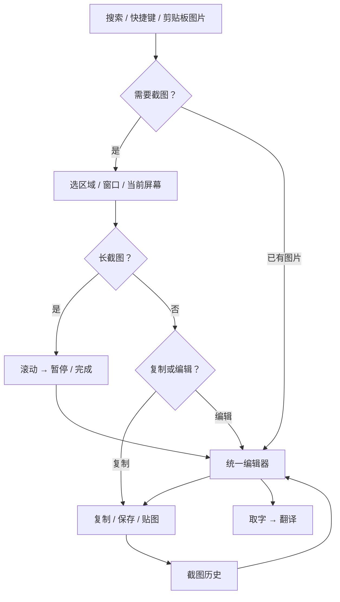

# Capture 一期交互设计

状态：v0.2 可实施交互稿，2026-09-23。对应 [Spec](capture-spec.md) 和 [Plan](capture-plan.md)。

2026-09-24 后续交互方向见[统一工作区方案](capture-unified-workspace.md)：原位图标工具栏、同一选区切换截图/长图/录制。本文和下方原型保留 v0.2 基线；2026-09-24 原生首个切片的当前行为与证据见[落地记录](capture-workspace-implementation.md)。下文的“复制或编辑”确认分支和 More 收纳属于旧方案，已经由原位图标栏替代。

[打开可点击原型](capture-prototype/index.html)。原型使用虚构文档和本地模拟状态，不截取桌面、不访问剪贴板、不进行识别/翻译或系统授权。
原型外侧场景导航、异常注入和外观切换是评审工具，不进入产品。

## 1. 一条主流程



Capture Text / Capture & Translate 在选区确认后直接进入取字/翻译，不强制绕到编辑器。
长截图完成后统一进入编辑器，用户可以检查接缝再输出。

## 2. 表面与视觉规则

- 沿用 Tinycast 的 scrim + behind-window vibrancy，暗色白色 alpha ramp、浅色黑色 ramp；不另建一套品牌色。
- 截图像素是内容，保持自己的颜色，不随外观反转。工具条和菜单是浮动 glass；编辑画布不是一整块 glass。
- AppKit 持有窗口 frame、鼠标 hit testing、画布与文字 responder；SwiftUI 持有工具选择、菜单与状态视图。
- 编辑器采用独立可调整窗口，失焦不关闭。Capture 遮罩和控制条不占用 launcher 的 frame，也不挤进 PaletteScreen。
- 全部 glyph 在生产实现通过 SymbolImage。图标 hover 显示标签和实际快捷键；按钮内不印快捷键。
- 工具和输出视觉分组：工具置左、主输出置右；唯一高强调动作是当前主动作。
- 确认用 DialogController，成功用既有 HUD。保存面板期间不把失焦误判为关闭。

初始尺寸为设计建议，实施时进入 Theme 的新增 Capture tokens；已有间距和圆角复用，不修改旧值：

| 表面 | 初始尺寸/布局 | 缩放规则 |
| --- | --- | --- |
| 截图遮罩 | 当前显示器；选区最小 2 × 2 px | 屏幕/内容 pixels 不随 Interface Size 改变 |
| 编辑器 | 960 × 680 pt；最小 720 × 480；可用屏幕不足时 clamp | 窗口记住用户尺寸；工具 chrome 随 Interface Size |
| 工具条 | 36 pt 图标容器；不足宽度折叠次要工具到 More | 基于现有 28 pt 按钮 + 4 pt 外侧留白 |
| 长截图控制条 | 约 420 pt 宽，最多两行；贴在选区外侧 | 无位置放置时用内容过滤排除，不覆盖输出 |
| 长截图预览 | 128 pt 宽、最高 240 pt；可收起 | 固定预览内存，不按最终长度撑高窗口 |
| 取字面板 | 420 × 360 pt 起步，可展开到 640 × 540 | 沿用 Translation Mini/expanded 的尺寸语言 |
| 贴图 | 按图片比例，初始不超过屏幕可用区 60% | 显示分辨率预览；缩放时按需读 tile |

可用屏幕比最小窗口还小时，以可用区域为上限，工具折叠，图片通过缩放和平移完整到达。
panel radius 26、row/card 10、menuPanel 16；间距优先使用 4/6/8/12/20 pt。
照片/图片区域可用现有 checker tokens 表达透明像素；不能把 checker 样式应用到所有主表面。

## 3. U01：入口与权限

Launcher 搜索“截图 / capture / 长截图 / scroll / OCR”，展示 Spec 中 8 个命令。所有条目允许别名和热键。
进入 Capture 设置可以集中配置；不在每个功能旁增加独立热键录制器。

首次需要截屏且未授权时：

```text
允许屏幕捕获
Tinycast 需要此权限来截取你选择的区域。
[稍后]                         [前往系统设置]
```

说明通过 Tinycast Dialog 展示，真实系统授权另由 macOS 呈现。返回 Tinycast 后显示“重新检查并开始”，不立即截图。
原型里的“模拟授权”只用于评审，不能作为产品按钮文字。
没有权限仍能编辑或贴出已有剪贴板图片。

## 4. U02：区域 / 窗口选择

- 画面冻结、光标十字；拖动选择区域，角点可调整；尺寸标签写原图 pixels。
- Space 在区域/窗口选择间切换，窗口 hover 高亮；点击窗口确认。阴影是否保留遵循设置/模式的明确值。
- 默认区域拖动限制在本屏幕；切换屏幕明确开始新选区。统一工作区扩展已增加 Display → Select Across Displays，显式进入后可跨屏拖选；长截图和录制仍绑定单屏/单窗口。
- 普通选区小条：主动作 `复制`，次动作 `编辑`、`长截图`；取字、翻译、贴图和保存从 More 进入，各专用命令仍直达。
- Return 确认主动作；普通选区 Command-C 也直接复制。Escape 取消；未确认时不写文件历史或剪贴板。
- 长截图只能选实际可滚动内容；方向选择在捕获前显示，默认“纵向”。

## 5. U03：长截图

进入长截图后取消冻结遮罩，让页面继续响应真实滚动。细边框标识区域，控制条与预览位于区域外。

```text
                 ┌───── 原应用实时内容 ─────┐    ┌── 已捕获 ──┐
                 │                         │    │ 缩略预览   │
                 │   用户滚轮 / 自动滚动    │    │           │
                 │                         │    └───────────┘
                 └─────────────────────────┘
  纵向 · 1600 × 4820 px     [自动滚动] [暂停] [完成] [×]
  在选区内滚动页面
```

| 状态 | 主文案 | 可执行动作 | 状态转移 |
| --- | --- | --- | --- |
| 等待首帧 | 准备捕获… | 取消 | 首帧有效 → 手动滚动 |
| 手动滚动 | 在选区内滚动页面 | 自动滚动、暂停、完成、取消 | 有效片段使长度增加 |
| 自动滚动 | 正在自动滚动 | 暂停、完成、取消 | 首次需要 AX 时先暂停并解释权限 |
| 用户暂停 | 已暂停，内容已保留 | 继续、完成、取消 | 继续前重新配准 |
| 匹配失败 | 画面变化较大，已暂停 | 重试连接、保留已有内容、重新选择 | 不追加未匹配帧 |
| 目标变化 | 原窗口已变化，已暂停 | 重新确认窗口、保留已有内容 | 未确认不发滚动事件 |
| 无进展 | 没有发现新内容 | 继续手动、完成 | 不直接断言到底 |
| 达到资源上限 | 已达到本次捕获上限 | 保留已有内容、取消 | 不继续分配大图 |
| 完成处理 | 正在准备图片… | 取消处理 | 成功 → 编辑器；失败 → 可重试的已捕获内容 |

暂停与取消的区别：暂停保留会话并可继续；取消有新增内容时询问“保留已有内容 / 丢弃 / 返回”。
点击完成不会保存历史或复制，先进入编辑器检查结果。

全局热键再次触发可完成当前捕获。Return/Escape 只在控制条持有 key focus 时响应；鼠标在页面上滚动无需键盘拦截权限。
自动滚动速度放 More 菜单，采用慢/中/快三档，不让参数控件占据主操作条。

## 6. U04：统一编辑器

```text
● ● ●           长截图 · 未保存           [取字] [翻译] [贴图]

    ┌── 图片画布，按视口读取 ───────────────────────────┐
    │ 原始像素保持清晰；长图可滚动；选中标注有操作柄    │
    └─────────────────────────────────────────────────┘

[选择 箭头 框 椭圆 T 画笔 编号 遮盖 裁剪 ⋯]     [保存] [复制]
1600 × 4820 px                       适合窗口 ▾ · 100%
```

- 普通图默认适合窗口；纵向长图默认适合宽度，横向长图默认适合高度，沿长轴滚动；整图概览为次动作。缩放以指针/画布中心为锚点，不改变文档像素。
- 工具条显示当前工具；选中标注时出现最少必要选项，如颜色、粗细、字号，避免常驻大 inspector。
- 实色遮盖默认不透明；像素化可选。OCR 识别合成后的图像，不能绕过遮盖。
- 点击标注可移动/调整；Delete 删除；拖动过程合并为一次 Undo。文字先进入 TextKit 编辑，再提交到画布。
- TextKit 编辑期间 Command-C 是复制选中文字，Return 换行；Command-Return 完成文字输入；Escape 先结束当前输入状态。
- 非文字编辑时 Command-C 复制最终图片；复制成功后默认关闭，失败保留全部内容。Command-S 异步另存，成功后窗口保留。
- 裁剪不销毁原图，保存的是裁剪参数；导出和贴图使用裁剪后结果。裁剪可以撤销。
- 未标注/未裁剪的普通新截图，关闭或重新截图直接结束；有实际编辑、用户原有草稿或已拼成长图时才询问“保留 / 丢弃 / 取消”。保留写为草稿，主动保存草稿也可从 More 进入。Copy/Save 成功后的相同 revision 不再提示。
- 点击另一个应用不关闭编辑器。打开菜单、颜色选项、保存面板不会造成重复保存或清空画布。
- 导出中保存 revision 固定。导出后又修改的内容仍标为未保存，不把新修改错误标成已输出。

原型的绘制/缩放只用于交互验证；图像导出、原生文本编辑、像素化强度和 native rendering 在 G2/G4 验证。

## 7. U05：贴图

贴图没有标题栏，仅 hover 或键盘聚焦时浮出 `复制 / 编辑 / 透明度 / 关闭`。
拖动图片移动；捏合/滚轮缩放；缩放锚点是指针，显示尺寸受屏幕限制。
点击背景应用保留贴图。关闭只关闭这一张，不删除历史，不影响其他贴图。
“编辑”使用贴图的冻结 revision；编辑器改动不会自动刷新贴图。
最多三张；超限提供“先关闭一张贴图”的提示，不能悄悄移除最早一张。

## 8. U06：取字与翻译

取字与翻译使用同一个文本结果面板，保留来源预览、可编辑原文及译文区域；长文通过文本框自身滚动。
截图来源默认失焦保留；切回原应用核对后再返回，校正的原文、译文和任务仍在。显式关闭才结束会话，不要求用户先置顶。
识别处理中显示“正在识别文字…”，取消不改变剪贴板。
空结果显示“未找到文字”，提供重新选择和返回编辑；低质量图片不假造内容。
超出识别上限明确标注部分结果，复制按钮改为“复制已识别部分”。

点击翻译时：

1. 优先取非空文本选区，否则取面板全部文本。
2. 超过 12,000 UTF-8 bytes 显示“内容过长，请选中一部分再翻译”，不自动截断。
3. 在同一面板进入翻译状态，复用现有 Translation 视图与服务，来源为截图；旧 target 清空。
4. 使用现有 Apple/AI 选择、语言策略和展开能力；Capture 会话失焦保留，原选区翻译维持既有 blur 行为。截图来源不显示回填动作，Copy 保留。
5. 翻译失败保留原文；返回编辑器仍然能查看截图。输出不覆盖原截图。

## 9. U07：历史与重新编辑

历史使用 palette 的日期分组和小缩略图；条目显示尺寸、时间，以及“平面图片”或“可编辑原稿”。
主动作 Open in Editor；Actions 有 Copy、Pin、Reveal、Delete。
平面图片重新打开后可添加新标注；可编辑原稿可调整原来的标注，两者不混淆。
删除需要既有删除语义的确认；正在编辑或导出的文件不能因后台 retention 清理而消失。

原稿保留设置默认关闭，说明其包含打码前内容；设置之外不重复弹隐私弹窗。
Copy/Save 已成功而历史失败时，通知写“已复制，历史保存失败”，不能让用户误以为复制也失败。

## 10. U08：设置

Capture 位于 Settings 的功能组中，采用 grouped Form：功能、输出、长截图、历史、快捷键、权限。
“自动滚动”是本次捕获动作，不是启动时持续运行的总开关。
设置默认值与 Spec §8 一致；备份不传递授权或原稿留存开关。

## 11. 键盘与焦点契约

| 情境 | 按键 | 行为 |
| --- | --- | --- |
| Launcher | ↑/↓、Return | 选择并执行 Capture 命令 |
| 选区 | Space、Return、Command-C、Escape | 切换窗口选择、执行主动作、普通选区直接复制、取消 |
| 长截图控制条持有 key | Space、Return、Escape | 暂停/继续、完成、取消流程 |
| 原应用持有 key | 原应用按键 | 不拦截普通文字/Return/Escape；按钮和已绑定热键可完成 |
| 画布 | V/A/R/O/T/P/N/B/C | 选择/箭头/矩形/椭圆/文字/画笔/编号/遮盖/裁剪；文本编辑时不触发工具 |
| 画布 | Command-Z / Shift-Command-Z | 撤销/重做 |
| 画布 | Command-C / Command-S | 复制最终图/保存；文字选区优先 |
| 编辑器 | Command-0 / Command-1 | 恢复默认适配（普通适合窗口、纵向适合宽度、横向适合高度）/100% |
| 编辑器 | Escape | 关闭菜单 → 取消当前操作 → 取消选中 → 关闭请求，逐级处理 |
| 编辑器 | Command-W | 统一关闭请求，处理未保存内容 |
| 文本编辑 | Command-Return | 完成当前文字输入，IME 先处理组合状态 |
| OCR | Command-C | 有选区复制选区；全量复制另有明确按钮 |
| Translation | 既有快捷键 | 保持当前翻译模块语义，截图来源不可回填 |

字母快捷键按当前键盘布局解析，不照搬 Macshot 的全套全局 keycodes。
可操作元素具备 VoiceOver 名称、selected/disabled 状态与固定 Tab 顺序；画布不是按钮唯一的命中方式。
Reduce Motion 下取消弹性位移，状态与按键语义相同。放大 Interface Size 后主动作必须可见，次要工具可折叠。

## 12. 原型覆盖和原生差距

原型提供入口搜索、选区切换、长截图手动增长/自动增长/暂停/失败/完成、标注与撤销、复制/保存反馈、贴图、
OCR/翻译模拟、历史回开、设置和权限分支。可以切换 Light/Dark；异常注入在评审条中。
原型不模拟真实配准准确度、系统级焦点、TCC、Carbon、保存面板、真实 OCR/翻译、剪贴板交付和内存预算。
绘制仅支持标注新增的撤销/重做；裁剪框、缩放、单行文字和单张贴图是交互示意，未实现像素级裁剪、
完整编辑历史、TextKit IME 或多个原生窗口共存。横向模式验证状态与尺寸，示例素材沿用同一篇虚构文档。
评审导航允许直接切换场景，不代表产品可以跳过未保存确认；刷新页面重置全部模拟数据。
这些差距在 Plan G0…G7 中有独立验收项，不能以浏览器点击通过代替。

## 13. 评审路径

1. 普通截图 → 选区 → 直接复制；另走编辑 → 无改动关闭/重截，验证没有草稿确认。
2. 入口 → 长截图 → 选区域 → 开始手动 → 增加内容 → 暂停/继续 → 完成 → 可读正文 → 编辑/复制。
3. 长截图自动模式 → 注入拼接失败 → 保留已有内容 → 保存，确认结果没有被清空。
4. 编辑器 → 箭头/遮盖 → 撤销/重做 → 贴图 → 透明度/关闭。
5. 编辑器 → 取字 → 校正原文 → 同面板翻译；切换应用再回来，检查内容保留且没有 Replace。
6. 权限未授予 → 不继续捕获 → 模拟授权后重试；对照现有图片编辑不依赖截屏权限。
7. 历史 → 平面/可编辑条目 → 重新打开；Light/Dark 下检查主动作、禁用状态和文本对比度。
