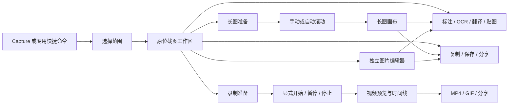

# Capture 完整能力整合与统一交互方案

状态：已确认设计 v0.2，2026-09-24；A/B/C/D 已有增量实现，尚未全部交付；最新状态与验收记录见[落地记录](capture-workspace-implementation.md)。基于 Tinycast 当前工作区（HEAD `5a78753`，含未提交 Capture / Translation）与 Macshot 本地 `a93bf38` 源码。

用户本轮扩大目标：吸收 Macshot 有价值的完整捕获、图片编辑、录制、视频处理和输出能力，同时保持便捷、简洁的操作。本文接续[一期 Spec](capture-spec.md)、[实施 Plan](capture-plan.md)与[交互设计](capture-interaction.md)。一期验收仍按[原有验收记录](capture-acceptance.md)追踪；不能用新增路线图替代未关闭的内存、原生兼容性和生命周期验收。

## 1. 结论

采用一个持续存在的捕获工作区：选区确定后，可以直接标注、复制、取字、翻译、贴图，也可以沿用范围开始长截图或录制。普通截图不再必须点击 Edit、打开独立窗口才能标注。

产品上统一入口、范围选择、图标语言和输出习惯；实现上分别维护静态图片、滚动捕获和视频录制的状态与资源。保留专用快捷命令，它们只是同一工作区的预设，熟练用户可以继续一步直达。

功能完整与界面简洁同时成立的原则：**常用动作直接可见，工具属性按需出现，切换任务沿用选区，增加能力不增加普通截图的操作步骤。**

## 2. 源码对照得到的主要发现

| 观察 | 源码事实 | 设计影响 |
| --- | --- | --- |
| Macshot 的不同入口最终共用捕获流程 | `AppDelegate.beginCaptureOCR / beginCaptureTranslate / beginScrollCapture / beginRecordArea` 设置意图后进入 `startCapture` | 借鉴“快捷命令是预设”；用明确的请求类型替代一组 pending 布尔值 |
| 选区确认后仍在同一工作区 | `OverlayView.finishSelection()` 进入 `.selected`、显示工具栏；可以直接取字、翻译、长图、录制 | 选区应是后续操作的对象，而非一次性提交表单 |
| 图标栏确实是简洁感的重要来源 | `ToolbarLayout.bottomButtons / rightButtons` 使用 SF Symbols；`ToolOptionsRowView` 根据当前工具显示属性 | 统一小图标、弱按钮底色、选中态强调；不以隐藏常用功能换取简洁 |
| 录制准备会替换工具栏 | `rightButtons(isRecording: true)` 返回开始、声音、麦克风、摄像头等；底部标注栏为空 | 开始前保留范围；切换到录制后只展示录制相关选项 |
| Macshot 复用编辑能力，也积累了很强的视图耦合 | `EditorView: OverlayView`；本地 `OverlayView.swift` 10,389 行，`AppDelegate.swift` 3,412 行 | 复用文档、渲染和工具交互；Tinycast 用组合方式连接桌面与窗口宿主 |
| Macshot 的窗口选取不等于窗口跟随录制 | `RecordingConfiguration` 保存 displayID/sourceRect；`RecordingEngine` 使用 display filter + `config.sourceRect` | 对用户区分固定区域录制和绑定窗口录制；窗口语义不能仅由边框形状决定 |
| Tinycast 目前没有视频录制引擎 | 现有 Capture 命令与服务包含普通截图、长图、OCR 等；没有 SCStream 视频写入与视频时间线 | “录制”属于新增交付，不能作为现成功能只换入口 |
| Tinycast 会在确认时拆掉选区 | `CaptureCoordinator.confirmSelection()` 先 `overlay.close()`，再依据 command / edit 分支 | 原位编辑要改变会话交接，不能只把文字按钮换成图标 |
| Tinycast 的窗口编辑器已经有部分图标工具 | `CaptureEditorView` 中标注工具为图标，但顶部取字/翻译/贴图与底部输出是文字按钮；颜色、线宽始终出现 | 问题包含流程割裂、重复操作区与常驻属性，不是“当前所有控件都没有图标” |
| OCR 坐标能力已经存在 | `TextRecognitionResult.Box` 包含 text/rect；`CaptureCoordinator+Text` 当前主要消费 result.text | 原位翻译、文字高亮和自动遮盖可扩展现有结果，无需创建第二套识别服务 |
| 当前图片文档不是自由拼版画布 | `CaptureDocument.validated()` 要求 Piece 沿单轴连续铺满 | 新增自由图片图层；不能简单把拖动后的图片塞进现有条带数组 |
| 当前 session 类型尚不限制合法转换 | `CaptureSessionState.advance` 只拒绝 closed 后的变化，其他状态可以直接互转 | 扩展前补齐事件与状态约束，保留现有 session ID / revision 防迟到结果机制 |

以上表格是实现前的代码审查快照；当前落地变化见文末关联记录。没有把 Macshot README 的功能声明当成 Tinycast 已验收事实。本轮未运行 Macshot 全功能测试。

## 3. 把“模式”分成三个维度

| 维度 | 用户在决定什么 | 选项 |
| --- | --- | --- |
| 范围 | 取哪里的内容 | 区域、窗口、当前屏幕；跨屏组合是扩展能力 |
| 捕获方式 | 取一帧、滚动内容还是一段时间 | 截图、长截图、录制 |
| 内容动作 | 得到内容之后怎么处理 | 标注、OCR、翻译、打码、贴图、美化、复制、保存、分享 |

主入口为 Capture，默认区域截图。默认不记住“上次录制”并自动进入录制；复用上次范围、直接长图、直接取字、直接翻译、快速复制和录制命令仍可独立绑定快捷键。既有 CommandID 保留，归属仍只在 SettingsTab 声明，不新建全局快捷键系统。

范围与捕获方式不是任意组合都有效：

| 范围 | 截图 | 长截图 | 录制 |
| --- | --- | --- | --- |
| 区域 | 冻结帧裁剪 | 绑定窗口内实际滚动视口；固定一个方向 | 屏幕上的固定矩形 |
| 窗口 | 独立窗口图像，保留边界语义 | 进入窗口内选取滚动视口；不自动将标题栏计入长图 | 目标设计为绑定 windowID 的窗口录制；独立验证移动、遮挡、最小化、关闭 |
| 当前屏幕 | 整屏一帧 | 需要圈定滚动内容，不能自动滚动整个桌面 | 指定显示器录制 |
| 跨屏范围 | 图片合成，定义混合倍率的输出坐标 | 收敛为一个显示器内的滚动视口 | 本轮全能力目标中不额外承诺跨显示器视频拼接 |

窗口跟随录制是对参考项目语义的明确增强；如果先交付固定矩形录制，入口必须显示“区域录制”，不能标成窗口录制。

## 4. 主流程与可见工具



### 4.1 普通截图：先让最常用路径变短

1. 快捷键唤起；拖动选区域，悬停窗口显示轮廓、点击确认窗口；屏幕选择有明确图标入口。空白处单击不隐式截全屏。
2. 松手保留选区，出现移动/缩放手柄、像素尺寸和紧贴选区的图标栏。此时直接画箭头、文字或打码。
3. Command-C / Return 复制并结束；Command-S 保存；取消未编辑截图不出现保存询问。
4. 独立编辑器作为“展开编辑”的显式动作，用于长图、历史、多图拼版和需要更大空间的处理；保留文档、选择与撤销状态。

从命令到普通截图复制仍是“唤起 → 选区 → 复制”；增加功能不会额外增加确认页。快捷 OCR / 翻译保留选区后直接处理的路径。

### 4.2 工具栏布局

- 选区下方：范围选择、截图/长图/录制三个紧凑图标；截图状态继续放箭头、形状、文字、画笔、荧光笔、编号、遮盖、撤销/重做等常用图标。
- 选区右侧：复制、保存、贴图、OCR、翻译、分享、展开编辑、取消。常用图标有稳定位置，复制为默认完成动作。
- 工具属性只在当前工具有相关属性时出现。例如箭头显示颜色/线宽/箭头样式；文字显示字体/对齐；遮盖显示像素化/模糊/实色；未选工具时没有常驻颜色和线宽选择器。
- 次级能力按语义分组：形状家族、遮盖家族、图像处理、导出选项。尺子、取色、放大镜、贴纸等可从工具库加入常用栏。不能把取字、翻译、贴图、长图统一塞进 More。
- 使用同一套图标尺度与点击区域，只有 hover / selected / enabled feedback 改变底色。沿用 Theme / InterfaceMetrics，不复制 Macshot 的视觉常量，不新增大块标题或永久说明。
- 每个图标包含本地化名称、accessibilityLabel、悬浮名称与快捷键；特殊状态保留必要文字，例如“开始录制”“已暂停”“保存失败”。图标化不要求错误提示也变成图标。
- 小选区和屏幕边缘由布局策略换边或吸附安全边缘；空间不足换行，保持组内顺序。长图/录制时控制条在采集区域外并从捕获过滤器排除，不能靠用户手动搬开工具条保证输出正确。

### 4.3 长截图：沿用选区，原页面可继续滚动

点击长图图标，保留范围并确认滚动目标。控制条换成方向、手动/自动、开始。默认纵向、手动；方向在开始前确定，捕获中不能静默变轴。

开始后解除冻结、让鼠标作用于原应用；只显示尺寸/进度、自动开关、暂停、完成，以及可折叠的窄预览。选择普通截图时的标注不烘焙到后续滚动帧。

完成后打开适宽（纵图）或适高（横图）预览，复用图片标注与输出。目标窗口移动、焦点变化、遮挡、滚动方向异常时按现有安全策略暂停，保留已经拼好的内容。用户可继续、保存当前结果或重选。

### 4.4 录制：同一范围，明确开始

点击录制图标只进入准备，保留范围；显示系统声音、麦克风、摄像头、鼠标/按键效果与设置。音频和摄像头状态必须在开始前可见，首次默认关闭；切换到录制不得隐式开始、打开麦克风或申请一串无关权限。

显式开始后隐藏标注工具与准备面板，显示时间、暂停、停止；同时保留菜单栏停止入口。原应用继续接收操作。摄像头、点击和按键效果是可导出的内容层；操作条是必须排除的 UI，两者不能一起排除整款应用了事。

停止后展示视频预览和基础裁剪时间线；需要时增加切除片段、变速、定格、局部放大、遮盖、文字。静态图片仍用图片画布。导出支持 MP4 / GIF，音轨音量和质量在相关操作时展开。

### 4.5 切换、撤销与焦点规则

| 场景 | 行为 |
| --- | --- |
| 截图切到长图/录制准备 | 沿用几何范围；截图及撤销栈暂存在当前会话，返回截图可以继续；不新增永久历史、不放宽原图保留策略 |
| 已有标注后开始长图/录制 | 准备区显示“沿用范围，标注保留在截图中”；输出是新的文档/媒体，不把静态标注误当录制内容 |
| 正在长图/录制时切模式 | 先完成或取消当前采集；不通过图标切换悄悄终止媒体写入 |
| 修改截图选区 | 基于原始冻结图调整裁切边界；标注使用文档坐标，保持位置并可撤销，不因缩小范围永久删掉边界外标注 |
| 改窗口/显示器 | 更换内容来源，不能把旧标注当成新画面的标注；保存当前会话检查点后重新选择 |
| 文本编辑中按快捷键 | IME 与 NSTextView 优先；字母工具键不截获输入；Command-C 先复制选中的文本 |
| Escape | 先退出文本/属性/工具操作，再返回上一准备状态；最终离开有未保存内容的会话时沿用保留规则 |
| 正在录制时 Escape | 不静默删除录像；使用明确的暂停/停止动作，保留停止入口 |
| OCR/翻译结果迟到 | 核对文档 ID / revision / session；过期结果不覆盖新图、不写入当前剪贴板 |
| 返回其他应用 | 保留既有焦点保护；用户主动切走后不强行抢回原窗口；截图来源不具有原文本写回目标 |

## 5. 完整能力清单与落点

“纳入整合”表示完整产品目标；现有项仍需按验收记录验证。按工作流交付闭环，而不是按按钮数量宣称完成。
下表第三列记录制定方案时的基础与拟新增内容；当前实现和待验项以[交付状态](capture-delivery-status.md)为准。

| 能力族 | 纳入的能力 | Tinycast 当前基础 / 新增内容 | 交付批次 |
| --- | --- | --- | --- |
| 统一入口与选择 | 区域、窗口、当前屏幕、拖动/缩放、原位标注、快捷复制 | 基础捕获已有；持续选区和宿主切换待实现 | A |
| 选择增强 | 尺寸/比例、边缘吸附、元素吸附、上次范围、延时、跨屏图片合成 | 新增；元素吸附按需使用 Accessibility；跨屏定义混合倍率 | B |
| 常用标注 | 箭头、线条、矩形/椭圆、文字、画笔、编号、遮盖、裁剪、撤销重做 | 已有基础工具；补齐移动/缩放/旋转、样式、字体与工具属性 | A / B |
| 高级标注 | 曲线箭头、荧光笔/文字高亮、聚光灯、放大镜、尺子、取色、Emoji/图片贴纸、对齐吸附 | 新增工具与手势；按工具家族组织 | B |
| 遮盖增强 | 像素化、模糊、实色、周边取色擦除；PII、人脸/人物、仅文字候选框 | 新增自动检测和候选复核；输出渲染使用确定后的遮盖，不能只盖编辑器预览 | B |
| 长截图 | 纵/横、手动/自动、暂停继续、实时预览、已有内容恢复 | 已有实现和 Arc 四种真实输出；补完整矩阵及统一工作区 | A |
| OCR / QR | 选区/编辑结果/长图 OCR；修正、复制；QR 内容识别、复制/打开 | OCR 与坐标已有；QR 新增。参考实现检测 qr/microQR，其他条码不算现成能力 | A / B |
| 翻译 | 文本面板、原位覆盖、多段翻译、原文切换 | 复用 Translation Apple/AI 配置；原位排版与分块映射新增 | A / B |
| 图片处理 | 裁剪、翻转、背景移除、反色、亮度/对比度/饱和度/锐度 | 裁剪已有；新增非破坏编辑描述与预览/导出一致性 | B |
| 美化 | 窗框、阴影、圆角、边距、纯色/渐变/网格背景 | 新增图像处理面板；避免变成截图前置步骤 | B |
| 多图编辑 | 追加截取、粘贴图片、自由图层摆放、组合输出 | 新增 ImageLayer 模型；保留长图条带不变量 | B |
| 贴图 | 截图/剪贴板图片贴图、移动/缩放/透明度、回编辑、复制保存 | 现有贴图基础继续完善；复用文档与来源租约 | A / B |
| 历史与缩略图 | 图片/录像历史、可编辑结果、快速预览、拖拽、右键动作、可选完成缩略图 | 图片历史已有；扩展媒体类型；默认复制成功仍可直接返回原应用 | B / D |
| 录制基础 | 区域/屏幕、绑定窗口、延时、暂停/恢复/停止、菜单栏停止、MP4 | 新增 RecordingEngine、媒体写入、录制生命周期 | C |
| 录制增强 | 系统声/麦克风、多音轨、摄像头、点击提示、按键展示、帧率与结束动作 | 新增媒体采集与内容合成；权限按功能请求 | C |
| 视频编辑 | 预览、首尾裁剪、区间切除、变速、定格、局部放大、遮盖、文字、静音/音轨音量 | 新增 VideoDocument、时间映射、预览与导出；不套用图片撤销结构 | D |
| 图片导出 | PNG/JPEG/HEIC，尺寸/质量、1×、色彩配置；AVIF/WebP 目标支持 | PNG/JPEG/HEIC/AVIF 已有；WebP 已获官方 libwebp 依赖例外 | B / D |
| 视频导出 | MP4 / GIF、分辨率、帧率、质量、进度、取消和失败恢复 | 新增导出任务；预览与导出共用编辑快照 | C / D |
| 分享与上传 | 系统分享、复制文件；Google Drive、S3/R2/MinIO、imgbb 等可选目的地、复制链接 | 新增 Share 服务，沿用 Tinycast 凭据和网络原则；配置后由用户显式触发 | D |
| 产品外围 | 快捷键自定义、设置搜索、外观/本地化、命令别名 | 复用 Tinycast；不另起菜单栏应用、历史数据库所有者、热键管理或翻译账户 |

Macshot 的 Sparkle、历史迁移、旧系统兼容分支、全局单例与配置键不作为功能迁入。自动更新属于 fork 的发布机制；与 Tinycast 的现有更新路径统一设计，不因接入 Capture 引入第二套更新器。

## 6. 实现边界

```text
AppCore
└── CaptureCoordinator                     唯一长期入口与资源所有者
    ├── CaptureRequest / CaptureSession    意图、范围、状态、revision
    ├── Workspace / Window / Pin hosts    桌面原位、独立编辑、贴图
    ├── Still capture / Scroll / Recording 按需启动的不同采集实现
    ├── Image document + canvas            普通图、长图、图片图层
    ├── Video document + timeline          录像、音轨、时序效果
    └── Output / History / OCR / Translation / Share
```

名称描述职责，不要求同时新增以上所有类型。保持 `Features/Capture` 边界，只在能力落地时引入具体对象；不用通用插件框架包装内部工具。

### 6.1 先重构交接，后堆功能

1. 引入显式 CaptureRequest：范围提示、捕获方式和初始动作。CommandID 只负责构造请求；copy/edit/OCR 等不再靠 `Bool edit` 或多处 command 比较分支。
2. Session 明确允许的事件：选择、更新范围、切换准备、开始长图、暂停、开始录制、停止、输出、关闭。三个工作阶段分别保存具体状态，防止录制与长图同时占用输入/媒体资源。
3. 将当前 `CaptureCanvas` 私有 Canvas 的文档交互从 NSScrollView 宿主抽出；桌面 Overlay 与窗口 View 组合相同画布/工具状态。先复用 Renderer / Undo / Source，避免重新实现导出和打码。
4. 用有类型的动作描述生成工具栏：图标、名称、快捷键、可用性、是否需要属性。工具栏可见状态由会话和文档能力决定；不要把系统权限与文件 IO 放到按钮 View。
5. 原位与窗口编辑切换保留文档 ID、revision 和撤销栈；copy/save/OCR/pin 继续使用统一快照输出路径。

### 6.2 图片与视频共享到哪里

- 共享范围、几何转换、颜色/文本样式值、工具图标、动作语义与输出任务反馈。
- 图片维持不可变栅格来源、受限预览/tiles 与非破坏标注；自由 ImageLayer 是单独概念，不能破坏连续条带验证。
- 视频保存文件、音轨引用、时间段与效果；暂停时间、裁剪/变速后的时基和音画同步独立计算。Macshot 的 RecordingLifecycle、VideoTimelineMapping、VideoEffectSnapshot 等是比整个 OverlayView 更合适的参考边界。
- 所有耗时工作按 Tinycast Swift 6 与 CaptureWork 约定离开主线程；不增加 competing singleton 或第二套长期 actor；AppKit 只负责需要它的画布、事件和窗口桥接。

### 6.3 完整能力需要保留的资源约束

- 启动 Tinycast 不预热录制、摄像头、OCR、所有屏幕大图与视频时间线；结束会话取消任务、释放 buffers、缩略图与文件租约。
- 长图继续限制可见 tiles，不将整张图片常驻后再谈界面轻量。跨屏合成要有像素/内存上限与分块策略。
- 2026-09-29 用户要求将统一 100 MB 改为分场景预算：普通截图 300 MB、长图/OCR/贴图 512 MB、录制/视频 600 MB；同时约束关闭回落与循环增长。规则见 [Spec](capture-spec.md#内存和性能-gate)，预算修订本身不等于原生验收通过。
- Macshot ImageEncoder 导入 Swift-WebP；项目锁定 Sparkle、Swift-WebP 与 libwebp。Tinycast 已在 2026-09-29 获得用户对官方 libwebp 静态组件的明确批准；只保留这一依赖例外，不引入 Swift-WebP wrapper 或包链。系统 ImageIO 未提供 WebP 写入，导出由内置组件负责。
  具体取舍、尺寸限制和推荐方案见 [WebP 独立决策](capture-webp-decision.md)。
- 复用现有 OCR 文字框、Translation 和 Clipboard mutation handshake，保持 copy/history 一次提交及迟到结果隔离。自动遮盖不能改变“最终图片默认落盘、可编辑原图保留须按设置”的隐私行为。

### 6.4 便于持续吸收 Tinycast 上游

上游稳定接点保持在 AppCore、命令目录/分发、SettingsTab、Palette 路由、Theme 的确需新增项。算法、画布、视频、导出和功能设置留在 Features/Capture，Translation 保留自己的协调器。每个纵向闭环保持可独立审阅的提交。

未来同步以原 Tinycast 为 upstream；Macshot 作为有版本记录的参考来源，按模块吸收改进。两个产品目录与所有权不同，不能承诺直接 merge Macshot 就能自动获得全部功能。未在本轮创建 fork、修改 remote 或替换已安装应用。

本地 Macshot 根许可证为 GPLv3，Tinycast 为 AGPLv3-or-later；GNU 的[许可组合说明](https://www.gnu.org/licenses/license-compatibility.en.html)明确说明 GPLv3 / AGPLv3 可以组合。移入具体源码时逐文件记录来源版本、原许可证与修改，保留通知并按组合后的条款交付源码；不能统一抹掉原许可证。本轮原生实现复用 Tinycast 的画布、标注与输出代码，没有移入 Macshot 源码。

## 7. 交付顺序与退出标准

| 批次 | 可独立交付的结果 | 必须验证 |
| --- | --- | --- |
| A：统一截图工作区 | 原位标注、移动/缩放、紧凑图标、直接输出、选区转长图、已有 OCR/翻译/贴图直达 | 热键→选区→复制不加步骤；标注不另开窗；窗口/原位撤销一致；四种长图；小选区、屏幕边缘、文本输入、焦点和资源释放 |
| B：完整图片能力 | 选择增强、高级标注、遮盖/原位翻译、处理美化、多图编辑、图片导出和历史 | 预览=导出；打码不可绕过；文字坐标/裁剪/图层变换一致；混合倍率；大图编码、复制与回收 |
| C：录制闭环 | 同一选区进入准备，录音/摄像与效果按需启用，暂停/结束，MP4 可播放可保存 | 真实开始/取消/停止，权限拒绝恢复，窗口语义，音画同步、暂停无跳变、控制条排除、睡眠/磁盘不足、输出独立解码 |
| D：视频与交付 | 完整时间线、GIF、媒体历史、可选上传 | 裁剪/变速/定格组合时基；视频遮盖导出；音轨混合；取消不破坏源文件；各目的地回读与失败恢复 |

每批以真实可用的垂直流程结束；后续未实现按钮不进入正式 UI。当前一期未完成的验收穿插于 A，不能因录制列入目标而跳过。原生功能交付仍需仓库要求的测试、Debug 零新增警告、lint、Model 纯度和真实 UI 验收。

已开始落地的第一个切片：**保留当前捕获/拼接/输出服务，打通“选区 → 原位画箭头或打码 → Command-C”并支持同一选区转长图。** 这一步同时验证状态与画布边界，后续高级图片和录制可以沿此入口接入。

## 8. 源码定位

以下路径为本机检阅入口，行号对应本次工作区。

- Tinycast：[命令与选区生命周期](/Users/bytedance/code/github/tinycast/Tinycast/Features/Capture/UI/CaptureCoordinator.swift:52)、[选择 UI](/Users/bytedance/code/github/tinycast/Tinycast/Features/Capture/UI/CaptureOverlayController.swift:105)、[编辑器](/Users/bytedance/code/github/tinycast/Tinycast/Features/Capture/UI/CaptureEditorView.swift:11)、[画布宿主](/Users/bytedance/code/github/tinycast/Tinycast/Features/Capture/UI/CaptureCanvas.swift:4)。
- Tinycast：[文档与条带验证](/Users/bytedance/code/github/tinycast/Tinycast/Features/Capture/Model/CaptureDocument.swift:3)、[会话状态](/Users/bytedance/code/github/tinycast/Tinycast/Features/Capture/Model/CaptureSessionState.swift:3)、[OCR 文字框](/Users/bytedance/code/github/tinycast/Tinycast/Platform/TextRecognition/TextRecognitionResult.swift:3)、[统一输出](/Users/bytedance/code/github/tinycast/Tinycast/Features/Capture/UI/CaptureCoordinator+Output.swift:4)。
- Macshot：[入口与预设](/Users/bytedance/code/github/macshot/macshot/AppDelegate.swift:1081)、[选区完成](/Users/bytedance/code/github/macshot/macshot/UI/Overlay/OverlayView.swift:6741)、[底部与右侧工具栏](/Users/bytedance/code/github/macshot/macshot/UI/Toolbar/ToolbarDefinitions.swift:309)、[窗口复用](/Users/bytedance/code/github/macshot/macshot/UI/Editor/EditorView.swift:6)。
- Macshot：[录制配置](/Users/bytedance/code/github/macshot/macshot/Capture/RecordingConfiguration.swift:6)、[录制状态约束](/Users/bytedance/code/github/macshot/macshot/Capture/RecordingLifecycle.swift:5)、[捕获过滤器](/Users/bytedance/code/github/macshot/macshot/Capture/RecordingEngine.swift:225)、[视频效果](/Users/bytedance/code/github/macshot/macshot/UI/Editor/EffectsBandView.swift:59)。
- Macshot：[原位翻译](/Users/bytedance/code/github/macshot/macshot/Services/TranslationOverlay.swift:5)、[QR 实际类型](/Users/bytedance/code/github/macshot/macshot/Services/VisionOCR.swift:65)、[图片格式](/Users/bytedance/code/github/macshot/macshot/Services/ImageEncoder.swift:83)、[跨屏合成](/Users/bytedance/code/github/macshot/macshot/AppDelegate.swift:2489)。

草图评审阶段的验证范围：源代码静态对照、源码链接与文档检查；交互草图通过 JavaScript 语法检查，浏览器验证原位标注、截图转长图、录制准备/暂停/结束、返回截图保留标注。1024 px 与 320 px 视口检查通过，窄布局未出现横向溢出。

草图使用模拟内容，不能证明真实采集、键盘/焦点、编码与网络行为。草图评审阶段未修改生产 Swift；后续原生实现的构建与验证结果单独记录。

原生实现与逐项证据集中在[统一工作区落地记录](capture-workspace-implementation.md)。草图是设计基线；具体哪些能力已经实现、哪些已通过原生验证，以落地记录为准。
